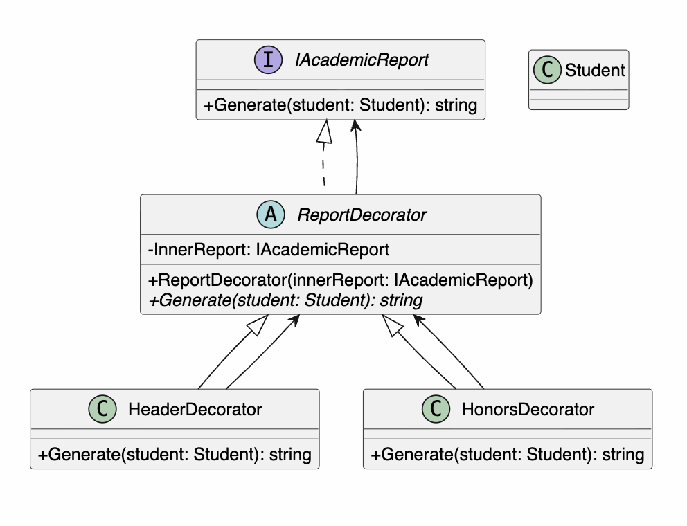
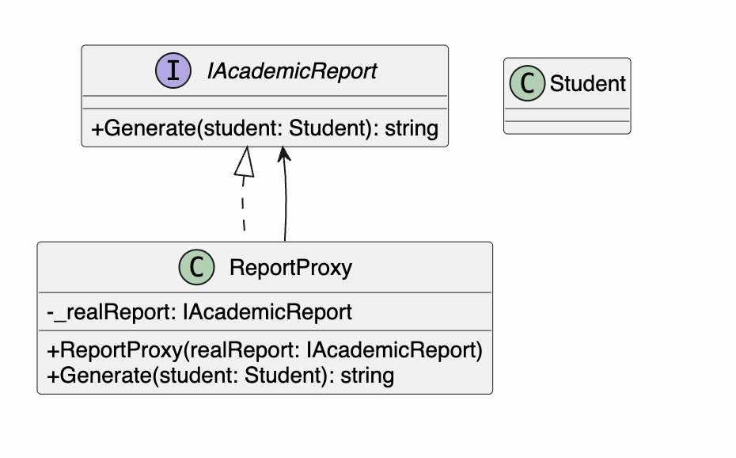
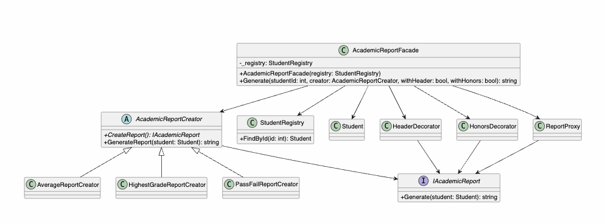

# Technical University of Moldova — FCIM
# Laboratory Work No. 2 — Structural Design Patterns
**Student:** Tataroi Bianca-Andreea  
**Group:** FAF-242  
**Course:** TMPS  
**Language:** C# (.NET 10)

## 1. Domain description

This project builds directly on Lab 1's Student Grade Management System, preserving student creation, listing, editing, deletion, grade assignment and average/highest/pass-fail reporting. The new version adds optional report formatting and honors classification, a guarded report-generation operation, and a single service to coordinate creating and generating reports. All data is stored in memory.

## 2. Decorator pattern

**Intent:** Add optional content to academic reports without changing each concrete report class. `IAcademicReport` is the common component interface, `AverageReport` (and two other report types) are concrete components, `ReportDecorator` is the base decorator, and `HeaderDecorator` and `HonorsDecorator` are concrete decorators.

### UML class diagram


### Code snippet
Source: [`Structural/ReportDecorators.cs`](Structural/ReportDecorators.cs)
```csharp
public abstract class ReportDecorator : IAcademicReport
{
    protected readonly IAcademicReport InnerReport;
    protected ReportDecorator(IAcademicReport innerReport) => InnerReport = innerReport;
    public abstract string Generate(Student student);
}

public class HeaderDecorator : ReportDecorator
{
    public HeaderDecorator(IAcademicReport innerReport) : base(innerReport) { }
    public override string Generate(Student student)
    {
        return $"ACADEMIC REPORT - {student.Name}\n" + InnerReport.Generate(student);
    }
}
```
A decorator delegates to the wrapped object and adds a header or classification. The two wrappers can be nested in either order.

### Automated tests
- **Decorator: header adds information** — verifies that a report has both header and original grade result.
- **Decorator: two wrappers work in either order** — verifies that both types of additional content remain available in either wrapper order.

## 3. Proxy pattern

**Intent:** Control access to real academic reports. `ReportProxy` and concrete reports implement the same `IAcademicReport` interface. The proxy blocks report generation if a student has no grades, but otherwise forwards the call unchanged.

### UML class diagram


### Code snippet
Source: [`Structural/ReportProxy.cs`](Structural/ReportProxy.cs)
```csharp
public class ReportProxy : IAcademicReport
{
    private readonly IAcademicReport _realReport;
    public ReportProxy(IAcademicReport realReport) => _realReport = realReport;

    public string Generate(Student student)
    {
        if (student.Grades.Count == 0)
            throw new InvalidOperationException("Add at least one grade before generating a report.");
        return _realReport.Generate(student);
    }
}
```
The check occurs before the real report is invoked.

### Automated tests
- **Proxy: blocks students without grades** — confirms the proxy throws an expected exception.
- **Proxy: returns unchanged report for valid students** — confirms the proxy's output equals the direct real report's output.

## 4. Facade pattern

**Intent:** Hide the multi-step report workflow behind one method. `AcademicReportFacade` uses Lab 1's registry and Factory Method together with Lab 2 decorators and proxy, without implementing grade calculations itself.

### UML class diagram


### Code snippet
Source: [`Structural/AcademicReportFacade.cs`](Structural/AcademicReportFacade.cs)
```csharp
public string Generate(int studentId, AcademicReportCreator creator,
    bool withHeader = false, bool withHonors = false)
{
    Student student = _registry.FindById(studentId)
        ?? throw new InvalidOperationException("Student not found.");

    IAcademicReport report = creator.CreateReport();
    if (withHeader) report = new HeaderDecorator(report);
    if (withHonors) report = new HonorsDecorator(report);
    report = new ReportProxy(report);
    return report.Generate(student);
}
```
This method coordinates rather than replacing existing report objects.

### Automated tests
- **Facade: generates a decorated report** — confirms the complete report includes a header, average result, and classification.
- **Facade: refuses unknown student ID** — confirms a missing student is rejected.

## 5. Interaction and extension

Menu option 7 calls the Facade, which looks up a student using the existing **Singleton**, creates an `IAcademicReport` using the existing **Factory Method**, adds zero or more **Decorators**, wraps the result in a **Proxy**, and calls `Generate`. Therefore a single execution path uses all three structural patterns, and the client depends on abstractions rather than choosing concrete report implementations inside the pipeline.

A new decorator can be introduced as another `ReportDecorator` subclass without modifying `AverageReport`, `HighestGradeReport`, `PassFailReport` or the other decorators. A new report class and matching creator can also be added. To expose additional user choices, only application-level configuration/menu wiring may need adjustment.

## 6. Running and test evidence

```bash
dotnet build
dotnet run
dotnet run -- --test
```

The test command runs **six automated checks, two per structural pattern**, from [`Tests/PatternTests.cs`](Tests/PatternTests.cs). The runner prints PASS/FAIL results and exits nonzero if any test fails.

**Screenshots to add before submitting:** main menu, generated decorated report, blocked no-grade report, console showing all six passing tests. Actual execution should be verified on your Mac; these are not claimed as already executed.

## 7. Conclusions

The main challenge was integrating three structural design patterns into an existing Lab 1 project without rewriting its creational patterns or modifying the original report classes. Decorator makes reports configurable, Proxy validates whether a report may be generated, and Facade coordinates the process behind one method. A future version could extract report formatting from the console application and use a standard unit-test framework.
